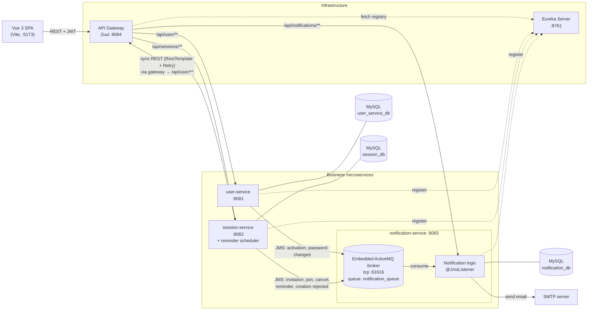
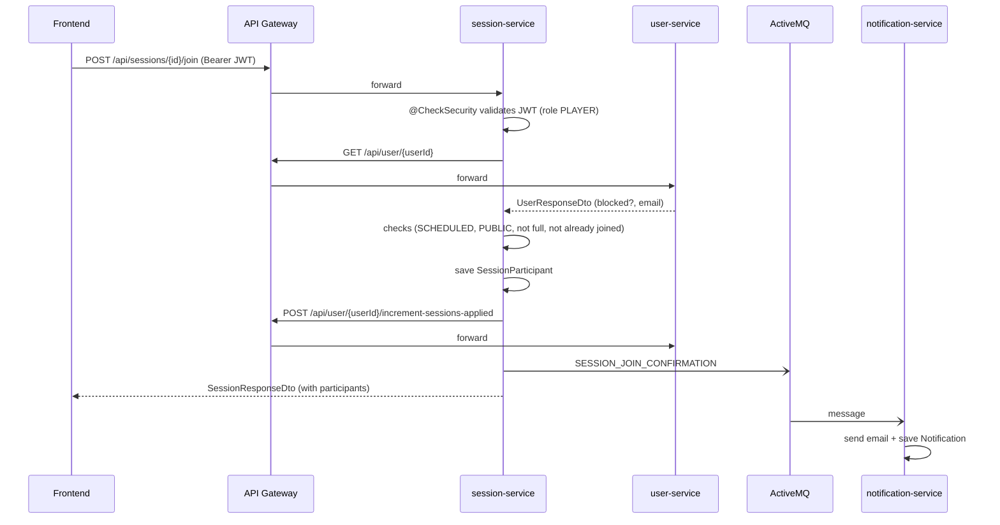

# GameLobby – Microservice-Based Gaming Session Platform

**Authors:** Aleksandar Radovanović 40/2023 RN and Katarina Gordić 41/2023 RN
*University project for the course **Softverske komponente** (Software Components).*

GameLobby is a web platform where players can **organize, join and manage gaming sessions**. The backend is a set of Spring Boot microservices behind a Zuul API gateway with Eureka service discovery. Services talk to each other through synchronous REST calls and asynchronous messages over ActiveMQ. A Vue 3 single-page application is the user interface.

---

## Table of Contents

- [Main Features](#main-features)
- [Technologies Used](#technologies-used)
- [Architecture](#architecture)
- [Microservices and Responsibilities](#microservices-and-responsibilities)
- [Communication Between Services](#communication-between-services)
- [Project Structure](#project-structure)
- [How to Run the Project](#how-to-run-the-project)
- [Configuration](#configuration)
- [API Overview](#api-overview)
- [Testing](#testing)
- [Known Limitations](#known-limitations)

---

## Main Features

**Accounts and users**
- Player registration with email account activation (activation link sent by email)
- Login with a JWT token (claims: user id, username, role)
- Viewing and editing your profile; changing your password (with an email notification)
- Two roles: `PLAYER` and `ADMIN`
- Admins can list all players and block or unblock them; blocked users cannot log in, create sessions or join them
- Player statistics: sessions applied, attended and missed, attendance percentage, number of organized sessions
- Organizer titles given automatically by the number of organized sessions (`BARJAKTAR` ≥ 10, `HAJDUK` ≥ 25, `VOJVODA` ≥ 50, `KNEZ` ≥ 100)

**Gaming sessions**
- Admin-managed catalogue of games (create, update, delete)
- Creating `PUBLIC` or `PRIVATE` sessions for a game, with a player limit and a start time
  - only allowed for users who are not blocked and have an attendance percentage of at least 90%; otherwise a rejection email is sent
- Joining and leaving public sessions (checks capacity, duplicates and blocked status)
- Private sessions are invitation-only: the organizer invites a user, who gets an email with a one-time invitation link
- Cancelling a session (by the organizer or an admin) emails every participant
- Closing a session: the organizer records who attended, and the session updates each player's statistics in the user service
- Filtering sessions (game, type, max players, description text, participant) and sorting them (start time, participant count)
- A scheduled job emails reminders to participants about 60 minutes before a session starts

**Notifications**
- Asynchronous, queue-driven email delivery (SMTP)
- Each sent notification is stored and can be viewed in the UI (admins see all, players see their own)

---

## Technologies Used

| Area | Technologies |
|---|---|
| Language / runtime | Java 11 |
| Backend framework | Spring Boot 2.2.2, Spring Web (MVC), Spring Data JPA (Hibernate) |
| Microservice infrastructure | Spring Cloud Hoxton.SR1: Netflix **Eureka** (service discovery), Netflix **Zuul** (API gateway) |
| Messaging | Spring JMS + **Apache ActiveMQ** (embedded broker hosted by the notification service) |
| Resilience | **Resilience4j Retry** (exponential backoff) for inter-service REST calls |
| Security | JWT (`io.jsonwebtoken:jjwt` 0.9.1, HS512), a custom `@CheckSecurity` annotation enforced by a Spring AOP aspect, Spring Security (stateless sessions, CORS, CSRF disabled) |
| Persistence | MySQL 8 (a separate schema per service) |
| Email | Spring Boot Mail (SMTP) |
| Other | Bean Validation (`javax.validation`), Lombok (notification service), Maven + Maven Wrapper |
| Frontend | Vue 3, TypeScript, Vite, Pinia, Vue Router, Axios, Tailwind CSS |

---

## Architecture



Key architectural points (taken from the code):

- **Single entry point.** The frontend only talks to the Zuul gateway at `http://localhost:8084`. Zuul routes by path prefix to services, which it finds by their Eureka service id.
- **Database per service.** Each business service owns its own MySQL schema. The session service stores only user ids and asks the user service for user data.
- **Synchronous calls for data you need right away.** The session service calls the user service over REST to check users (blocked status, attendance, role, email) and to update player statistics. It sends these calls **through the API gateway**, using a `RestTemplate` whose base URL is `http://localhost:8084/api`.
- **Asynchronous calls for side effects.** The user and session services publish JSON messages to the ActiveMQ queue `notification_queue`. The notification service consumes them, sends emails and stores a record of each one.
- **Decentralized authorization.** The user service issues JWTs. The user and session services validate them locally with the same shared signing secret, using the `@CheckSecurity` aspect. The gateway does not check tokens.

---

## Microservices and Responsibilities

| Service | Port | Responsibility |
|---|---|---|
| `eureka-service` | 8761 | Eureka service registry (`@EnableEurekaServer`) |
| `api-gateway` | 8084 | Zuul reverse proxy (`@EnableZuulProxy`), routing and global CORS filter |
| `user-service` | 8081 | Users, registration and activation, login (JWT issuing), profiles, block/unblock, player statistics and organizer titles |
| `session-service` | 8082 | Games catalogue, gaming sessions, participants, invitations, closing and cancelling sessions, filtering, reminder scheduler |
| `notification-service` | 8083 | Embedded ActiveMQ broker, JMS consumer, email composition and delivery, notification history |
| `frontend/frontend-app` | 5173 (Vite default) | Vue 3 SPA for players and admins |

### user-service
- **Entity:** `User` (username, email, password, names, date of birth, `Role`, `active`, `blocked`, activation token, statistics, `Title`)
- **Layers:** `UserController` → `UserService`/`UserServiceImpl` → `UserRepository` (Spring Data JPA), with `UserMapper` for DTO mapping
- **Security:** `TokenServiceImpl` generates and parses HS512 JWTs, and `SecurityAspect` enforces `@CheckSecurity(roles = …)`
- **Messaging:** sends `ACTIVATION_EMAIL` and `PASSWORD_CHANGED` messages through `JmsTemplate`
- **Endpoints for the session service:** increment/decrement sessions applied, update attendance, increment organized sessions

### session-service
- **Entities:** `Game`, `Session` (`SessionType` PUBLIC/PRIVATE, `SessionStatus` SCHEDULED/CLOSED/CANCELED), `SessionParticipant`, `SessionInvite`
- **Layers:** `SessionController` → `SessionServiceImpl` / `GameServiceImpl` → JPA repositories (including a JPQL filtering query in `SessionRepository`)
- **User service client:** `UserClientServiceImpl` uses `RestTemplate` wrapped in a Resilience4j `Retry` (3 attempts, exponential backoff starting at 1 s)
- **Scheduler:** `SessionReminderScheduler` runs every 5 minutes (`@Scheduled`) and sends `SESSION_REMINDER` messages for sessions that start in 60–65 minutes
- **Messaging:** sends `SESSION_INVITATION`, `SESSION_JOIN_CONFIRMATION`, `SESSION_CANCELED`, `SESSION_REMINDER` and `SESSION_CREATION_REJECTED` messages

### notification-service
- **Broker:** `ActiveMqBrokerConfig` starts a non-persistent ActiveMQ `BrokerService` on `tcp://localhost:61616`
- **Consumer:** `NotificationListener` (`@JmsListener` on `notification_queue`) → `MessageHelper` (JSON parsing + Bean Validation) → `NotificationService.process()`
- **Processing:** builds a subject and body for each `NotificationType`, sends the email with `JavaMailSender` and saves a `Notification` entity
- **REST:** read-only notification history

---

## Communication Between Services

| From → To | Mechanism | Purpose |
|---|---|---|
| Frontend → API Gateway | HTTP/REST (Axios, `Authorization: Bearer <JWT>`) | All UI operations |
| API Gateway → services | HTTP, routed by Eureka service id | `/api/user/**`, `/api/sessions/**`, `/api/notifications/**` |
| Services → Eureka | Eureka client registration | Service discovery |
| session-service → user-service | Synchronous REST through the gateway (`RestTemplate` + Resilience4j Retry) | Get user data, update statistics |
| user-service → notification-service | Asynchronous JMS (ActiveMQ queue `notification_queue`) | Account emails |
| session-service → notification-service | Asynchronous JMS (same queue) | Session emails |
| notification-service → SMTP | SMTP | Sending emails |

**Message format:** every producer serializes a `NotificationMessageDto` to JSON:

```json
{
  "recipientEmail": "player@example.com",
  "type": "SESSION_JOIN_CONFIRMATION",
  "data": { "sessionName": "Friday raid", "startTime": "2026-01-15T20:00" }
}
```

### Example flow: a player joins a public session



---

## Project Structure

```
softverskeKomponente-Projekat2/
├── eureka-service/          # Eureka service registry
├── api-gateway/             # Zuul gateway + CORS filter
├── user-service/            # users, auth (JWT), statistics
│   └── src/main/java/org/example/userservice/
│       ├── config/          # Spring Security / CORS
│       ├── controller/      # UserController
│       ├── domain/          # User, Role, Title
│       ├── dto/             # request/response DTOs, NotificationMessageDto
│       ├── exception/       # BadRequestException, NotFoundException
│       ├── helper/          # MessageHelper (JSON for JMS)
│       ├── mapper/          # UserMapper
│       ├── repository/      # UserRepository
│       ├── security/        # @CheckSecurity, SecurityAspect, SecurityContext, TokenService
│       └── service/         # UserService + impl
├── session-service/         # games, sessions, participants, invites
│   └── src/main/java/org/example/sessionservice/
│       ├── configuration/   # Retry, RestTemplate, Security
│       ├── controller/      # SessionController (sessions + games)
│       ├── domain/          # Game, Session, SessionParticipant, SessionInvite, enums
│       ├── dto/  exception/  mapper/  messaging/  repository/
│       ├── scheduler/       # SessionReminderScheduler
│       ├── security/        # JWT validation aspect
│       └── service/         # SessionService, GameService, UserClientService + impls
├── notification-service/    # embedded broker, JMS listener, email
│   └── src/main/java/org/example/notificationservice/
│       ├── config/          # ActiveMqBrokerConfig
│       ├── controller/      # NotificationController
│       ├── domain/  dto/  mapper/  repository/
│       ├── listener/        # NotificationListener + MessageHelper
│       └── service/         # NotificationService (templates + mail)
└── frontend/frontend-app/   # Vue 3 + TypeScript SPA
    └── src/
        ├── api/             # Axios client and API modules (auth, users, session, notifications)
        ├── components/  layouts/  views/
        ├── router/          # Vue Router
        └── stores/          # Pinia auth store (token + user in localStorage)
```

Each backend service is a separate Maven project with its own `pom.xml` and Maven Wrapper (`mvnw`, `mvnw.cmd`). There is no parent/aggregator POM.

---

## How to Run the Project

> The repository has no Docker or docker-compose setup. You start each service on its own.

### Prerequisites
- **JDK 11** (the services target Java 11 and use Spring Boot 2.2.x)
- **MySQL 8** running on `localhost:3306`
- **Node.js** `^20.19.0` or `>=22.12.0` (from `frontend-app/package.json`) and npm
- Your own **Gmail account with an App Password** for sending email (the configuration uses Gmail SMTP on port 587 with STARTTLS). See [Email setup](#email-setup-gmail).
- A separate ActiveMQ installation is **not** needed, because the notification service runs an embedded broker

### 1. Create the databases
The JDBC URLs do not create the schemas automatically, so create them first:

```sql
CREATE DATABASE user_service_db;
CREATE DATABASE session_db;
CREATE DATABASE notification_db;
```

Hibernate creates the tables (`spring.jpa.hibernate.ddl-auto=update`).

### 2. Configure credentials
Edit each service's `src/main/resources/application.properties` (see [Configuration](#configuration)):

- **Database:** in `user-service`, `session-service` and `notification-service`, set `spring.datasource.username` and `spring.datasource.password` to your local MySQL credentials.
- **Email:** in `notification-service`, replace the placeholders with your own Gmail address and App Password:
  ```properties
  spring.mail.username=YOUR_EMAIL@gmail.com
  spring.mail.password=YOUR_GMAIL_APP_PASSWORD
  ```
- **JWT secret:** `jwt.secret` can stay as it is for local use. If you change it, use the same value in `user-service` and `session-service`.

#### Email setup (Gmail)
The project does not include working email credentials. Every user, including new players, receives an activation link by email and cannot log in before activating the account, so you need your own sender account:

1. Create a Gmail account to use as the sender (a separate account just for this project is recommended).
2. Turn on **2-Step Verification** for that account (Google Account → Security).
3. Create an **App Password** (Google Account → Security → App passwords). Google shows a 16-character password.
4. Put the Gmail address in `spring.mail.username` and the App Password (without spaces) in `spring.mail.password`.

> The App Password is **not** the account's login password. It only lets the application send email through SMTP. Do not commit it to a public repository.

### 3. Start the services (in this order)

```bash
# 1. Service registry
cd eureka-service        && ./mvnw spring-boot:run

# 2. Notification service: it hosts the ActiveMQ broker, so start it before the producers
cd notification-service  && ./mvnw spring-boot:run

# 3. Business services
cd user-service          && ./mvnw spring-boot:run
cd session-service       && ./mvnw spring-boot:run

# 4. Gateway
cd api-gateway           && ./mvnw spring-boot:run
```

On Windows, use `mvnw.cmd spring-boot:run`. You can also run each `*Application` class from an IDE.

Open the Eureka dashboard at `http://localhost:8761` and check that `USER-SERVICE`, `SESSION-SERVICE`, `NOTIFICATION-SERVICE` and `API-GATEWAY` are registered.

### 4. Start the frontend

```bash
cd frontend/frontend-app
npm install
npm run dev
```

The app runs at `http://localhost:5173`. The backend CORS configuration only allows this origin.

### Admin account
There is no endpoint for creating an admin. Registration always creates a `PLAYER`. To use the admin features, set a user's `role` to `ADMIN` (and `active` to `true`) directly in `user_service_db.users`.

---

## Configuration

| Property | Service(s) | Description |
|---|---|---|
| `server.port` | all | Ports: 8761, 8084, 8081, 8082, 8083 |
| `server.servlet.context-path=/api` | user, session, notification | All business endpoints start with `/api` |
| `spring.datasource.url / username / password` | user, session, notification | MySQL connection (one schema per service) |
| `jwt.secret` | user, session | Shared HS512 signing key. **It must be the same in both services.** |
| `spring.activemq.broker-url` | user, session, notification | `tcp://localhost:61616` |
| `notification.queue.name` / `session.notification.queue` | user, notification / session | Queue name (`notification_queue`) |
| `eureka.client.serviceUrl.defaultZone` | all clients | Eureka URL. The gateway also reads the `EUREKA_URI` environment variable. |
| `zuul.routes.*` | api-gateway | Path-to-service-id routes (`strip-prefix=false`) |
| `spring.mail.*` | notification | SMTP host, port and credentials. The username and password are placeholders that you must replace (see [Email setup](#email-setup-gmail)). |

> ⚠️ **Security note:** never commit real database passwords, SMTP app passwords or JWT secrets. Replace them with your own local values, preferably through environment variables or an untracked local profile.

Some URLs are hardcoded in the code and only work locally:
- the user service base URL used by session-service: `http://localhost:8084/api` (`UserClientServiceConfiguration`)
- the activation link: `http://localhost:8081/api/user/activate/{token}` (`UserServiceImpl`)
- the invitation link: `http://localhost:8084/api/sessions/invite/accept/{token}` (`SessionServiceImpl`)
- the frontend API base URL: `http://localhost:8084` (`frontend-app/src/api/client.ts`)

---

## API Overview

All paths below are given **as seen through the gateway** (`http://localhost:8084`). Protected endpoints need the header `Authorization: Bearer <token>`.

### User service: `/api/user`

| Method | Path | Access | Description |
|---|---|---|---|
| POST | `/api/user/register` | public | Register a player (sends an activation email) |
| GET | `/api/user/activate/{token}` | public | Activate an account |
| POST | `/api/user/login` | public | Log in with `{email, password}` and get `{token}` |
| GET | `/api/user/me` | PLAYER, ADMIN | Current user's profile and statistics |
| PUT | `/api/user/profile` | PLAYER, ADMIN | Update first name, last name and date of birth |
| PUT | `/api/user/password` | PLAYER, ADMIN | Change password (sends an email) |
| GET | `/api/user` | ADMIN | List all non-admin users |
| PUT | `/api/user/{id}/block` · `/unblock` | ADMIN | Block or unblock a user |
| GET | `/api/user/{id}` | no token check | Get a user by id (used by session-service) |
| POST | `/api/user/{id}/increment-sessions-applied` | no token check | Called by session-service |
| POST | `/api/user/{id}/decrement-sessions-applied` | no token check | Called by session-service |
| POST | `/api/user/{id}/update-attendance?attended=` | no token check | Called by session-service |
| POST | `/api/user/{id}/increment-organized-sessions` | no token check | Called by session-service |

### Session service: `/api/sessions`

| Method | Path | Access | Description |
|---|---|---|---|
| POST | `/api/sessions` | PLAYER, ADMIN | Create a session (`name, gameId, maxPlayers, sessionType, startTime, description`) |
| GET | `/api/sessions` | PLAYER, ADMIN | All sessions with participant details |
| GET | `/api/sessions/{id}` | PLAYER, ADMIN | Session by id |
| GET | `/api/sessions/by-name?name=` | PLAYER, ADMIN | Session by name (case-insensitive) |
| GET | `/api/sessions/filtered` | PLAYER, ADMIN | Filters: `gameId, type, maxPlayers, description, userId`; sort: `sortBy=startTime\|participantsCount` |
| POST | `/api/sessions/{id}/join` | PLAYER | Join a public session |
| POST | `/api/sessions/{id}/leave` | PLAYER | Leave a session |
| POST | `/api/sessions/{id}/invite?invitedUserId=` | PLAYER (organizer) | Invite a user to a private session |
| GET | `/api/sessions/invite/accept/{token}` | public (token link) | Accept an invitation |
| POST | `/api/sessions/{id}/cancel` | organizer or ADMIN | Cancel a session and notify participants |
| POST | `/api/sessions/close` | organizer | Close a session with `{sessionId, participantsAttendance: {userId: bool}}` |
| GET | `/api/sessions/{id}/participants/count` | PLAYER, ADMIN | Number of participants |
| GET | `/api/sessions/{id}/participants/attended/count` | PLAYER, ADMIN | Number who attended (closed sessions only) |
| GET | `/api/sessions/games` · `/games/{id}` | public | List games / get a game |
| POST | `/api/sessions/games/create` | ADMIN | Create a game |
| PUT | `/api/sessions/games/update/{id}` | ADMIN | Update a game |
| DELETE | `/api/sessions/games/delete/{id}` | ADMIN | Delete a game |

### Notification service: `/api/notifications`

| Method | Path | Access | Description |
|---|---|---|---|
| GET | `/api/notifications` | no token check (used by the admin UI) | All stored notifications |
| GET | `/api/notifications/user?email=` | no token check | One recipient's notifications, newest first |

---

## Testing

Each backend service has only the default Spring Boot smoke test (`*ApplicationTests.contextLoads()`), which checks that the application context starts:

```bash
cd user-service && ./mvnw test
```

These are not isolated unit tests. Because `@SpringBootTest` loads the full context, the tests need the same infrastructure as a normal run (MySQL with the schemas created, and the ActiveMQ broker for user-service and session-service). The frontend has no automated tests. `npm run build` runs a TypeScript type check (`vue-tsc`).

**Manual end-to-end check:**
1. Register in the UI and open the activation link from the email.
2. Log in, open the profile and check the statistics.
3. As an admin, create a game. As a player, create a session, join it from another account and close it.
4. Check the **Notifications** page and your inbox.

---

## Known Limitations

This was a university project. These simplifications are visible in the code:

- Passwords are stored and compared in plain text (no hashing).
- JWTs are issued without an expiration claim (the `jwt.expiration` property is defined but never used).
- The gateway does not validate tokens. The internal statistics endpoints, `GET /api/user/{id}` and the notification endpoints have no token check and can be reached through the gateway.
- There is no global exception handler (`@ControllerAdvice`). Custom exceptions such as `BadRequestException` and `NotFoundException` are not mapped to specific HTTP status codes.
- session-service calls user-service through a hardcoded gateway URL instead of a load-balanced, discovery-based client.
- The embedded ActiveMQ broker is non-persistent, so queued messages are lost if the notification service restarts.
- There are no Docker/compose files, no externalized secrets and no automated business-logic tests.
